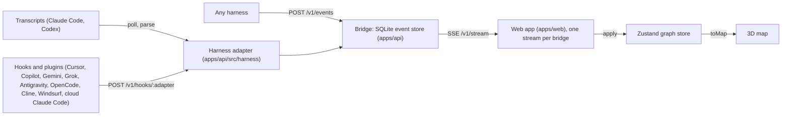

# System Architecture

## 1. Data flow



1. A **harness adapter** turns a harness's own record (a transcript line, a hook payload, a plugin event) into **events** from `packages/shared/src/events.ts`. Nothing else crosses the bridge. Which surface each harness uses is ADR-0006.
2. The **bridge** (`apps/api`, Bun + Hono) stores events in SQLite, dropping exact duplicates (ADR-0005), and streams them over SSE. A new client gets a `reset` and the whole history; a reconnecting client sends `Last-Event-ID` and gets only what it missed, also across restarts. `forget` tells clients a session was removed.
3. The **web app** (`apps/web`) follows every enabled bridge, folds each bridge's events into its own `Graph` with `apply`, merges them, applies the filters, and `toMap` turns the result into nodes and links.
4. Bridge **settings** (enabled adapters, their folders, retention, replay window) live in `$DATA_DIR/settings.json` and are edited through `GET/PATCH /v1/settings`.

## 2. Monorepo structure

Bun workspaces monorepo:
```
agent-map/
├── apps/
│   ├── web/        # Vite + React, TanStack Router and Query, Zustand, Tailwind 4, shadcn (src/, tests/)
│   ├── api/        # Bun + Hono bridge: harness adapters, SQLite store, SSE stream (src/, tests/, bin/ forwarder and plugin)
│   └── desktop/    # Tauri 2 shell: webview on apps/web/dist, bridge compiled as a sidecar (src-tauri/)
├── packages/
│   └── shared/     # Event schema, graph reducer, map layout (src/, tests/)
├── e2e/            # Playwright tests against recorded transcripts in e2e/fixtures
├── scripts/        # lint, test setup, demo run
├── Dockerfile, compose.yaml  # hosted bridge serving the built app
└── docs/           # Architecture, standards, ADRs, design guidelines
```

## 3. Event model

| Event | Meaning |
| --- | --- |
| `session.started` | A harness run began. Carries the harness name, a title and the working directory. |
| `agent.started` | An agent joined a session. `parentToolId` names the tool call that spawned it, else `parentAgentId` names its parent agent; `model` is optional. |
| `agent.stopped` | An agent finished. A subagent also stops when its spawning tool call finishes. |
| `tool.started` / `tool.finished` | A tool call began; it ended, successfully or not. |
| `message` | A prompt (`user`) or reply (`assistant`) of an agent, with the model that wrote a reply. A subagent's first prompt is its task; its last reply is its answer. |

The model of an agent's latest reply decides its provider (`packages/shared/src/providers.ts`), falling back to the harness.

The main agent of a session has the session's id. An event for an unknown session or agent creates it, so a harness that only reports tool calls still draws a tree.

## 4. Strict boundary rules

1. **One schema.** Every event is defined once in `packages/shared/src/events.ts`. Adapters, the ingest route and the web stream parse with it.
2. **Web never reads harness files.** `apps/web` reaches harnesses only through the bridge and imports only the bridge's types (`AppType`).
3. **Adapters own harness formats.** Transcript shapes, file layouts and hook payloads live in `apps/api/src/harness/<harness>.ts` and nowhere else. A file adapter declares globs and `append` or `snapshot` mode; the shared watcher (`files.ts`) does the polling. A hook adapter parses its payload with Zod and throws `InvalidPayload` on a foreign shape.
4. **The reducer is pure.** `apply` returns a new graph and never mutates its input, so Zustand and React see every change.
