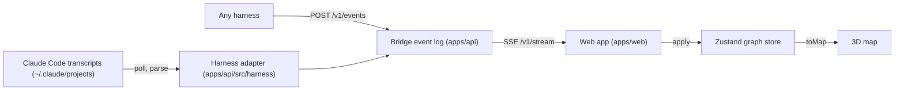

# System Architecture

## 1. Data flow



1. A **harness adapter** turns a harness's own record (a transcript line, a hook payload) into **events** from `packages/shared/src/events.ts`. Nothing else crosses the bridge.
2. The **bridge** (`apps/api`, Bun + Hono) appends events to an in-memory log and streams them over SSE. A new client gets a `reset` and the whole log; a reconnecting client sends `Last-Event-ID` and gets only what it missed.
3. The **web app** (`apps/web`) folds events into a `Graph` with `apply`, then `toMap` turns the graph into nodes and links for the 3D map.

## 2. Monorepo structure

Bun workspaces monorepo:
```
agent-map/
├── apps/
│   ├── web/        # Vite + React, TanStack Router and Query, Zustand, Tailwind 4, shadcn (src/, tests/)
│   └── api/        # Bun + Hono bridge: harness adapters, event log, SSE stream (src/, tests/)
├── packages/
│   └── shared/     # Event schema, graph reducer, map layout (src/, tests/)
├── e2e/            # Playwright tests against recorded transcripts in e2e/fixtures
├── scripts/        # lint, test setup, demo run
└── docs/           # Architecture, standards, ADRs, design guidelines
```

## 3. Event model

| Event | Meaning |
| --- | --- |
| `session.started` | A harness run began. Carries the harness name, a title and the working directory. |
| `agent.started` | An agent joined a session. `parentToolId` names the tool call that spawned it. |
| `agent.stopped` | An agent finished. A subagent also stops when its spawning tool call finishes. |
| `tool.started` / `tool.finished` | A tool call began; it ended, successfully or not. |

The main agent of a session has the session's id. An event for an unknown session or agent creates it, so a harness that only reports tool calls still draws a tree.

## 4. Strict boundary rules

1. **One schema.** Every event is defined once in `packages/shared/src/events.ts`. Adapters, the ingest route and the web stream parse with it.
2. **Web never reads harness files.** `apps/web` reaches harnesses only through the bridge and imports only the bridge's types (`AppType`).
3. **Adapters own harness formats.** Transcript shapes, file layouts and hook payloads live in `apps/api/src/harness/<harness>.ts` and nowhere else.
4. **The reducer is pure.** `apply` returns a new graph and never mutates its input, so Zustand and React see every change.
